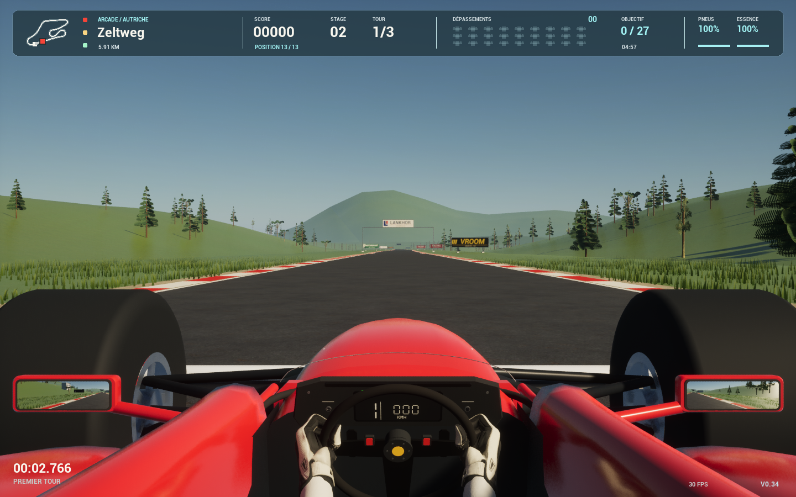

# Cockpit 0.34 — référence F1 et historique Amiga

## Direction actuelle : conserver le cadrage, finir le cockpit dans le style 1990

David conserve le cockpit guidé par sa photo : position des yeux basse, nez et côtés rouges visibles, vraies roues avant, mains à neuf heures et trois heures et gants blancs. Sa précision suivante porte sur la finition et les proportions, avec un **volant classique et aucun halo moderne**.

Les références visuelles consultées le 19 septembre 2026 sont le [volant Ferrari 641 de 1990 conservé dans le catalogue RM Sotheby's](https://rmsothebys.com/auctions/pa20/lots/n0006-ferrari-641-momo-steering-wheel-1990/) et les [photos du cockpit de la Ferrari 640 F1-89 chez Art & Revs](https://www.artandrevs.com/car.php?id=548). Elles montrent une jante ronde, trois branches, deux commandes simples et une instrumentation séparée du volant. Les photos guident les formes et matériaux ; leurs images et marques ne sont pas incorporées aux assets du jeu. Les modèles restent une interprétation originale, sans correspondance millimétrique revendiquée.

Le volant conserve son centre et ses prises latérales, avec une jante circulaire noire mate et trois branches métalliques sombres. Le rayon, l'épaisseur et la profondeur de la jante sont constants. **David a approuvé la nouvelle pose du pouce autour du cercle**, sans changer le cadrage, les bras ou le volant. Le tableau de bord est fixé à la coque : vitesse, rapport et régime restent lisibles sans tourner avec le volant. Les manches rejoignent le centre mesuré du bracelet, indépendamment du pivot pratique du modèle de gant. Leur extrémité suit son axe et se resserre sous le bracelet, tout en conservant le volume de l’avant-bras. Ce raccord est transformé et symétrisé avec chaque main à chaque image de braquage ; le cadrage naturel laisse sortir la main basse.

Les rétroviseurs restent derrière les pneus dans la géométrie de la voiture. Leurs coques ont maintenant des angles arrondis et une épaisseur galbée ; les supports rouges coudés rejoignent le cockpit. Le reflet arrière 3D partagé est actualisé à 30 ou 60 Hz selon les effets dans le cockpit, et à 10 Hz en poursuite, avec une première capture immédiate. La carrosserie et les épaules des pneus sont affinées, avec des normales séparées entre gomme et jantes afin de préserver les ouvertures.

La vue extérieure montre maintenant ce même cockpit, avec les mêmes gants et bras animés, le même volant et les mêmes rétroviseurs. Le pilote ajouté seulement en poursuite comprend le casque, le buste, le col et le harnais ; il ne contient plus une seconde paire de bras et de gants. Le cadrage intérieur, le nez visible et la pose des gants blancs vintage sont conservés. Les rivaux disposent de leur propre pilote avec bras et volant, ainsi que de quatre roues séparées pour le braquage et le roulement.

La finition arrière resserre les terminaisons des pontons autour du train roulant et rend lisibles la transmission, le diffuseur et les échappements. Les ailes ont des plaques latérales aux coins arrondis. Les géométries générées comptent **4 744 triangles pour la coque du joueur**, **268 pour l’aileron avant**, **1 144 pour le pilote extérieur** et **1 256 par roue à 40 segments**. Un rival complet compte **9 328 triangles**, avec des roues à 24 segments de **840 triangles chacune**. Les dimensions, centres et axes des roues restent inchangés ; les contrats d’export et les budgets sont détaillés dans [FINALISATION_034.md](FINALISATION_034.md#finition-des-monoplaces).

## Validation de la révision courante

La géométrie des voitures passe ses **22 contrôles ciblés**, dont les raccords arrière, le centrage des roues séparées, l’absence de bras dupliqués sur le pilote joueur et les bases UV non dégénérées. Les **10 contrôles des gants passent** : ils préservent leur topologie, leurs UV, les positions des 2 633 sommets hors pouce et les normales des 1 671 sommets des quatre autres doigts. Ils imposent une jante circulaire de rayon 11,9 cm, avec rayon de tube constant de 0,765 cm, et rejettent la face de pouce qui traversait auparavant ce cercle.

La pose retenue, `pulp-candidate-1`, utilise l’opposition du pouce du modèle articulé source, sans déplacer les mains ni modifier les poignets ou les quatre autres doigts. David l’a approuvée sur la capture `thumb-selected-neutral.png`. Le fichier `Content/Data/gloves.json` porte le SHA-256 `f342faa13e3c64a1883f2b2683ccc6b3e43edf2a565dc2a1cde2c7b06ea68908`. L’[audit enregistré](cockpit-grip-034.json) contrôle les **4 899 faces de chaque gant** contre une enveloppe conservatrice de toutes les faces de la jante : la séparation minimale garantie est **0,667 mm** dans le réglage courant. La pulpe mesurée au sommet 405 se trouve à environ **1,35 mm** de la jante, ses voisins à **3,17–3,23 mm**. L’outil [audit_cockpit_grip.py](../Tools/audit_cockpit_grip.py) refuse une construction géométrique différente de celles relues.

Le [contrôle séparé de la pose retenue](thumb-grip-034.json) ne détecte **aucune traversée transverse stricte pouce–index dans la région contrôlée**. Ce constat ne constitue pas une certification universelle de l’anatomie ou de toutes les auto-intersections du gant. L’audit de jante porte sur la pose par défaut et le cercle ; il ne certifie pas les branches, le tableau de bord, les manches, la carrosserie ni des paramètres de pose différents. Les anciennes valeurs de 1,547 mm de séparation et de 5,7 mm à la commissure concernaient la pose remplacée.

Le **package avec la pose approuvée est construit**, journal `Saved/Logs/vroom-034-thumb-selected-package.log`. Les **31 suites portables passent**, journal `Saved/Validation/v034/portable-thumb-selected.log`. La série visible `20260919-231125-package` termine avec **47/47 contrôles PASS**, dont huit mesures en Photoréalisme et six circuits complets : **29,996–30,000 images/s**, maximum **39,573 ms par image**, après préparation. Ses vues [neutre](images/cockpit-034-neutral.png), [droite](images/cockpit-034-right.png) et [gauche](images/cockpit-034-left.png) sont copiées sans retouche depuis ce rapport. Elles montrent la prise retenue et les manches recentrées dans le package validé.

La release **`0.34.0-c8a4441fbfd4` est installée**, avec vérification des empreintes du binaire, des données et du rapport. La 0.33 est conservée pour retour arrière. Le [rapport publié](validation-results.json) décrit le périmètre validé ; les mesures à 30 images/s ne certifient pas 60 images/s ni toutes les interactions possibles. L’état Git est consultable dans le [dépôt](https://git.estrasse.fr/david/vroom-unreal).

La série précédente `20260919-222926-package`, interrompue pour corriger le pouce après 38 cas fonctionnels, deux définitions et le parcours Autriche réussis, reste incomplète. Le package précédent R4 avait échoué sur le circuit USA avec une rafale CPU de 157,821 ms, conservée dans `Saved/Validation/v0.34.0/20260919-193242-package/results.json`. Ces résultats historiques restent distincts de la série finale réussie ; [FINALISATION_034.md](FINALISATION_034.md) détaille les preuves.

## Archive : référence Amiga et cockpit 0.30

Les observations et réglages qui suivent sont conservés pour la provenance du travail. Les mentions de caméra, d’échelle ou de placement « courant » décrivent la 0.30 ; elles ne prescrivent pas les réglages de la 0.34 photographique.

David a choisi explicitement l'édition **Amiga** le 6 septembre 2026. Les sources ST de juillet 1991 restent une référence technique pour les modèles et l'extraction ; elles ne prouvent pas à elles seules la parité avec l'édition Amiga commercialisée.

### Observation historique

Référence visuelle : [Vroom Longplay (Amiga), AL82](https://www.youtube.com/watch?v=U6bsfmMaFGU&t=138s), observée directement dans le lecteur. À 2:18, le cadre complet au rapport 1,60 montre un bandeau supérieur occupant environ 34 % de la hauteur : carte à gauche, colonne de trois feux, titre du Grand Prix et nom du circuit en jaune/orange, puis score, stage, tour, petites voitures et jauge verticale. Les proportions sont des mesures approximatives de la vidéo, pas des coordonnées extraites des sprites.

Le groupe roues/rétroviseurs occupe environ 54 % de la largeur. Le petit volant bleu marine, large d'environ 24 %, reste presque entièrement sous le cadre : son arc supérieur commence vers 86–88 % de la hauteur totale. Dans le sprite neutre extrait (`cockpit_pose_03.png`), les premiers pixels des gants se trouvent vers 91–91,5 % : le sprite est placé à y=172 sur l’écran de 200 pixels et le haut des gants vers y=10–11 dans ce sprite. Les rétroviseurs rouges sont devant les pneus sombres ; de petites liaisons claires les rejoignent. Les instruments comportent une grille de rapports à gauche, une vitesse numérique à droite et une barre de régime verte/ambre/rouge dessous. Deux petits voyants T/E encadrent le bloc.

À [2:02](https://www.youtube.com/watch?v=U6bsfmMaFGU&t=122s), un gant clair est haut sur la jante ; le poignet a un liseré ocre et les ombres/renforts sont bleutés. À 2:33 et 2:38, le gant gauche atteint 10–11 heures, avec l'avant-bras oblique venant du bas gauche ; l'autre main sort presque du cadre. Le repère rouge tourne avec la jante. La route et les concurrents sont visibles dans les rétroviseurs.

La vidéo a été revue directement dans le lecteur le **13 septembre 2026**, à [2:19](https://www.youtube.com/watch?v=U6bsfmMaFGU&t=139s) et [3:44](https://www.youtube.com/watch?v=U6bsfmMaFGU&t=224s). Ces vues confirment les petits rétroviseurs bas devant des pneus dont la surface extérieure est pleine.

### Application dans la 0.30

La référence a été précisée pendant la séance : **reprendre les formes en vraie 3D et moderniser l'interface**, sans afficher les sprites originaux dans la version jouable. Les sept images Amiga de 96 × 28 pixels, leur masque et leur palette restent des documents de travail dans `docs/reference/amiga` ; l'extraction est décrite dans [AMIGA_ART.md](AMIGA_ART.md).

Le volant, les mains et les manches sont des maillages avec volume, normales et matériaux éclairés. Les gants utilisent le modèle OpenXR de Valve : la prise des doigts est calculée une fois à partir des articulations, avec cuir ivoire, renforts sombres et coutures texturées. Le modèle source de main gauche reste à gauche sans miroir ; sa symétrie produit la main droite. La provenance et la licence sont dans [ASSETS.md](ASSETS.md).

Les deux gants sont des composants séparés, attachés à la racine du cockpit. Leur transformation est calculée dans le repère du volant : une prise locale fixe définit le contact, puis la même rotation entraîne la jante et les mains. La pose préparée referme les doigts autour de la prise et les manches rejoignent les poignets au fil du braquage.

À la suite de la demande de reprendre les mains au neutre comme dans l’Amiga, les captures de préparation ont été comparées aux sprites extraits. Le réglage courant réduit l’échelle des gants de **1,15 à 1,05** et porte l’inclinaison locale des poignets de **45° à 80°**. Ce paramètre est une rotation dans le repère du modèle, pas un angle anatomique mesuré sur une vraie main. Il vise le placement des dos des gants sur les flancs du volant au neutre. Le réglage de caméra et la plage de braquage restent inchangés.

Les paramètres de la prise sont regroupés dans **`Content/Data/gloves.json`, objet `driving_grip`** : angle neutre 30°, inclinaison du poignet 80°, échelle 1,05. Le rendu lit ces valeurs à son initialisation ; elles servent aussi à préparer la géométrie. Les options de diagnostic permettent encore de les surcharger pour des comparaisons, sans constituer les réglages de la version livrée.

Le réajustement local concerne **150 sommets sur 3 028**, d’après les métadonnées de génération. Il conserve la pose articulée et ne remplace pas les gants par une nouvelle forme. La distance minimale visée au cercle central de la jante est **1,215 cm** : rayon du tube de 1,2 cm plus un jeu de surface de 0,015 cm. Ce nombre ne signifie donc pas un espace de 1,215 cm entre la main et le volant. Le déplacement maximal déclaré des sommets ajustés est d’environ 0,914 cm dans le monde. Le contrôle géométrique de dégagement complète l’observation du contact dans les images ; il ne la remplace pas.

Le cadrage conserve le volant bas au neutre. **La main gauche monte dans un virage à droite ; la main droite monte dans un virage à gauche.** La main opposée descend et peut quitter le cadre tout en restant attachée à sa prise. La caméra n’est pas remontée pour garder les deux mains visibles.

Les sept dessins originaux servent de référence pour cette composition et le sens des gestes. Le rendu actif n’interpole plus des couples poignet/dos de main mesurés dans les sprites : ces positions d’écran ne suffisaient pas à assurer une prise cohérente sur une jante en volume. Le placement actuel est une adaptation 3D continue, sans correspondance pixel par pixel ni reconstruction exacte de l’anatomie revendiquée.

Le filtre visuel utilise la même commande pour la jante et les mains. Les avant-bras mettent à jour leurs sommets pour suivre les poignets ; les coudes restent sous le cadre. Le cockpit comprend onze composants et conserve son clignotement commun après récupération. L’appui visible, le cadrage au neutre et les mouvements à gauche et à droite doivent être évalués dans le rendu du build concerné ; une relation géométrique correcte ne suffit pas à valider l’apparence des doigts.

La grille des rapports, les trois chiffres de vitesse et la barre de régime suivent la simulation. Le pourtour bas du cockpit reçoit une surface carbone, un rebord rembourré et des fixations métalliques ; les instruments ont un cadre métallique et des rivets. Ces ajouts restent sur le pourtour existant et ne rehaussent pas la caméra pour montrer davantage de tableau de bord.

Les petits rétroviseurs restent **bas devant les pneus**, dans la composition inspirée de l’Amiga. Leurs supports courts rejoignent la coque et restent hors de l’enveloppe de braquage des roues. Ils partagent une vraie capture arrière 3D, actualisée à 30 ou 60 Hz selon la qualité des effets. Cockpit et miroirs se masquent en poursuite et partagent le clignotement de protection des roues.

Le défaut d’affichage des roues identifié le **13 septembre 2026** venait de l’ordre des sommets des triangles, ou *winding*. La bande de roulement, les flancs, les branches, le moyeu et une paroi interne de jante étaient orientés à l’envers pour Unreal. Le moteur éliminait leurs faces extérieures, laissant voir l’intérieur du pneu et de la jante. `Tools/bootstrap_car_assets.py` corrige ces surfaces sans déplacer les roues, la caméra ni les mains ; les anneaux de jante déjà correctement orientés sont conservés.

Les quatre tests de [car_wheel_surfaces_test.py](../Tests/car_wheel_surfaces_test.py) lancent des rayons vers la bande de roulement, les deux flancs, les faces et parois de jante, les branches et le moyeu. Ils vérifient que la première surface physique rencontrée regarde le rayon et sera donc visible. Les roues avant et arrière du joueur utilisent **40 segments**, celles des adversaires 20 ; les tests couvrent ces deux résolutions et le budget reste de **3 182 triangles par concurrent**.

Le HUD affiché est désormais dessiné avec **Canvas** : panneau bleu nuit translucide, angles arrondis, caractères modernes et accents cyan. Il mesure **84 pixels** de haut dans l’espace de référence 1440 × 900, environ **9,3 %** de la hauteur, avec une marge supérieure. Le grand bandeau 3D de 34 % n’est plus utilisé dans le parcours de rendu actif. La présentation conserve la carte, les trois voyants, le mode et le circuit, le score ou les points, le stage, le tour et l’essence. En Arcade, les 27 repères de dépassement restent présents ; en course Grand Prix, le bloc indique les treize positions et celle du joueur. En qualification, il rappelle l’objectif du tour propre ; en Chrono, il indique le record et la disponibilité du fantôme. Les vies et les règles complètes de l’arcade originale ne sont pas reproduites. Le chrono reste en bas à gauche ; vitesse, rapport et régime figurent sur le cockpit, ou en complément Canvas dans la vue de poursuite. Le dérapage et la poussée ont leur propre indicateur.

### Validation historique du package 0.30

**Le package Mac 0.30 passe la série `20260913-030921-package` du 13 septembre 2026** : 31 cas réussis, huit profils de cadence et six tours complets avec continuité vérifiée. Les empreintes du binaire, des données et des preuves sont conservées dans son `results.json`. Les contrôles portables finaux passent à 21/21, y compris les quatre tests de surfaces des roues et le contrôle de dégagement des gants.

Les captures normales `neutral.png`, `right.png` et `left.png` du package final montrent les pneus fermés, sans intérieur visible à travers leur surface, et les rétroviseurs en position basse. Les gants occupent les flancs de la jante au neutre ; en braquage, la main montante suit la jante tandis que l'autre peut sortir sous le cadre. La caméra conserve le cadrage bas. `options.png` montre le vrai panneau graphique, ses réglages et ses boutons Appliquer/Annuler. Ces vues sont distinctes de `inspect-neutral`, qui reste une vue technique de contrôle.

Les profils de cadence passent à environ 59,98–59,99 images/s en moyenne, avec un maximum de 22,83 ms, au réglage Performance à 70 % interne sur Mac Apple M5 24 Go. Ils ont été mesurés sous verrouillage (`onscreen_locked`, `interaction_verified=false`) : cette réussite porte sur la série automatisée. Les images fixes vérifient les poses montrées, sans certifier chaque instant de l'animation ni une session interactive.

Cette interface est une modernisation explicite des informations originales. Les références, le paramétrage commun et les contrôles de dégagement ne garantissent ni une fidélité intégrale du gameplay, ni une apparence correcte dans tous les angles, ni la fluidité d’un nouveau build. Les résultats datés et les empreintes du package finalement mesuré sont à consulter dans [VALIDATION.md](VALIDATION.md).
