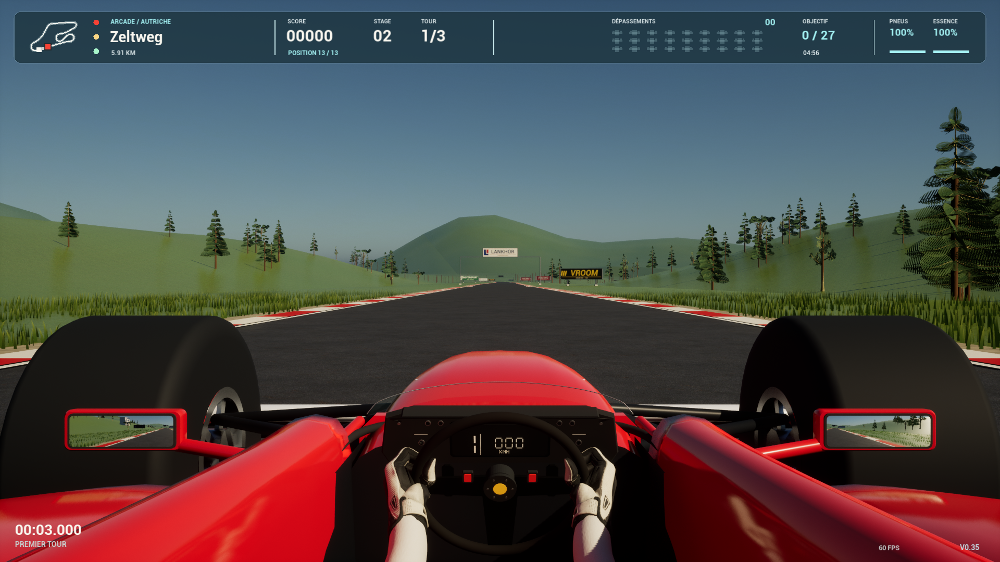

# Vroom 0.35 — conduite, glisse et collisions

Livraison du 4 octobre 2026. Le code du jeu commun est au commit `7e0182888e60fc6dcc9e04bced2f6cfec60289c0`. Les scripts de livraison et les preuves sont versionnés ensuite dans le même dépôt.

## Changements jouables

- **Drift en virage** : une vraie courbe et un braquage dans son sens sont nécessaires. En ligne droite, pas de déclenchement ni de charge. À la sortie, une fenêtre de 0,18 s permet de libérer le turbo gagné ; maintenir la glisse sur la ligne droite l’annule. Le contre-braquage clavier continu est accepté, avec une charge plus rapide quand il est dosé.
- **Conduite** : courte inertie latérale, reprise d’adhérence rapide et contre-braquage réactif. La voiture immobile ne conserve pas une vitesse latérale parasite.
- **Dégâts** : quatre zones pour le joueur et ses rivaux, intensité liée au choc, frottements contrôlés moins pénalisants. L’aileron avant et les carrosseries adverses se déforment. Les pertes d’adhérence et de pointe sont bornées pour rester jouable. La récupération permet de repartir ; les stands réparent complètement. Ce système ne constitue pas une simulation de déformation continue de toute la coque.
- **Rivaux** : accélération et pointe rapprochées du joueur, freinage et évitement conservés. L’assistance de peloton reste limitée à −2 % / +4 % et se coupe aux stands, hors piste et avec peu d’essence. Les essais de départ en air libre donnent un ratio de vitesse rival/joueur de **0,954 à 1,071** aux points de contrôle de 1, 2, 6 et 20 secondes, en difficulté normale.
- **Cockpit** : caméra abaissée de 3 cm, visière du tableau de bord et lentilles encastrées. Le volant circulaire, les gants blancs et leur prise approuvée sont conservés. Aucun asset Content n’a été régénéré.
- **Départ** : signal électronique plus bref et plus net, synthétisé à 880 / 1 320 Hz. Ce n’est pas un enregistrement officiel de F1. Séquence, pause et silence vérifiés.

## Preuves

| Contrôle | Résultat |
|---|---|
| Tests portables | 34 suites réussies ; nouvelles assertions d’exclusion de l’aide au peloton également réussies |
| Mac UE 5.8.3 | Compilation Editor/Game et package réussis ; signature vérifiée ; 11 scénarios visibles PASS |
| Windows UE 5.8.3 | Compilation Editor/Game et package réussis ; 11 scénarios visibles PASS sur RTX 5060 Laptop / D3D12 |
| Parité des sources | 198 fichiers Source/Config/Content et projet comparés par SHA256, zéro différence |
| Assets Mac | 149 fichiers Content présents avant/après, aucune modification |
| Cadence / longues sessions | Aucune nouvelle campagne FPS ou parcours prolongé, conformément à la demande |
| Linux | Sources communes disponibles ; aucun build ni essai natif 0.35 |

Les onze scénarios sur chaque plateforme couvrent ligne droite, drift clavier, drift expert avec lâcher parfait, dépassement IA, réparation aux stands, crash, frottement de roues, départ normal, pause, silence et cockpit neutre. Les fenêtres sont visibles au premier plan. Ces scripts n’attestent pas d’une séance de conduite humaine ni d’un essai de manette physique. Les captures cockpit et collision ont été examinées séparément.

Rapports : [Mac](validation-035-mac.json), [Windows](validation-035-windows.json). Journaux complets Mac dans `Saved/Builds/20261004-kart-derby/` et le conteneur Vroom ; Windows dans `C:\Vroom-Build-20260923\Logs\gameplay-035-20261004`, copie locale dans `Saved/Builds/20261004-kart-derby/windows-validation/`. Le [harnais Windows ciblé](../Tools/diagnostics/20261004/README.md) est conservé.

Empreintes des exécutables :

- Mac : `71e19423eb0ff56d32a60f7112b1bbbb9ea18699bfa72d771ad4efa5733a796e`.
- Windows natif : `1b7821f06aedc4d838da4b8df0d20c4e035470b5726893bc21cc12e83498647d`.

## Installation et retour arrière

**PC** : le raccourci bureau habituel `Vroom.lnk` remplace l’ancienne entrée et ouvre la 0.35. Package actif : `C:\Vroom-Build-20260923\Packages\Win64-035-final-20261004`. L’ancienne version 011 reste intacte ; le raccourci précédent est sauvegardé dans `Logs\Vroom-shortcut-before-035-20261004.lnk`. La validation ponctuelle est désactivée après réussite ; le jeu normal est lancé en session console 1, sans mode test ni fermeture automatique.

Le contrôle d’application Windows a refusé le petit bootstrap auxiliaire avec l’erreur 4551. Le raccourci et `Jouer.cmd` appellent désormais directement l’exécutable natif qui a passé les onze tests et le lancement normal. Aucune stratégie de sécurité n’est désactivée. La révision de `Jouer.cmd` conserve les mêmes binaires et données ; son manifeste et son ZIP sont recalculés.

ZIP livré : `Vroom-0.35.0-Windows.zip`, SHA256 `9e97195e0d9ba83241471bbe28a32a212b250ec426b19c06341365b982b8cb5d`. Une copie est placée dans Downloads sur le Mac.

**Mac** : les raccourcis `~/Desktop/Vroom 0.35.app` et `~/Applications/Vroom 0.35.app` pointent vers un lanceur avec l’icône rouge. Version installée : `0.35.0-71e19423eb0f-preview`, manifeste `~/Library/Application Support/Vroom/active-preview-035.json`. Le lanceur passe `-LLM`, comme le lanceur normal, pour éviter le défaut d’initialisation Cocoa du moteur. L’ancien raccourci `Vroom.app` et son manifeste `active.json` conservent la 0.34. Cette installation d’aperçu dispose d’une validation ciblée ; elle ne prétend pas satisfaire la campagne complète exigée par l’installateur historique.

Un essai Mac initial a échoué avant création du journal à cause de l’oubli de `-LLM` dans le petit harnais de test : pile `FLLMTracker::PopTag`. Le harnais a été corrigé et le scénario a ensuite passé. Aucun changement de moteur ni de modèle de langage.

